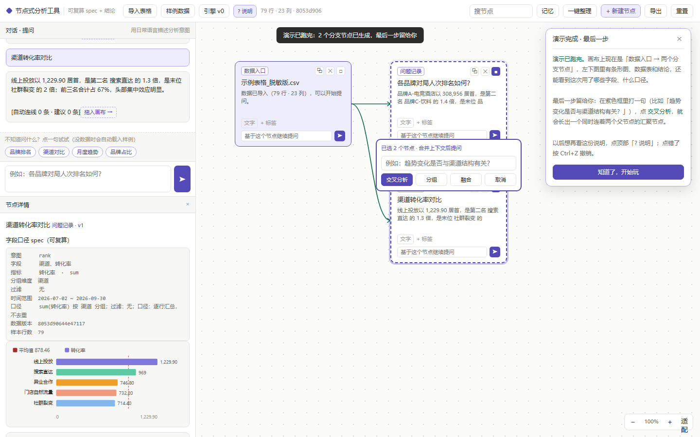

# 节点式数据分析工具

把每一次提问变成画布上的一张卡片，卡片之间用线连起来，能顺着线走回当时的推理过程。

一个零依赖的单文件 HTML，双击 `index.html` 就能用，不需要服务器、不需要安装、不需要联网。

在线预览：https://xiaoliuning6-svg.github.io/node-analysis-canvas/



## 三步上手

1. 点顶部「样例数据」，载入 79 行 × 23 列的示例表格，画布出现一张紫色「数据入口」卡片。
2. 在左下输入框打 `各品牌对局人次排名如何？` 回车，左侧出横向条形图、数据表和结论，画布长出一张分析卡片。
3. 再问 `渠道转化率对比`，勾住两张卡片右上角的方框，中间浮出紫色提问框，提交「交叉分析」，就得到一张同时连着两条分支的汇聚卡片。

不想打字可以点左下常驻的 4 个示例问题按钮；第一次打开会弹引导卡，里面「一键跑一遍演示」会自动把前三步做完，最后一步留给你自己点。更细的说明见 [使用手册.md](./使用手册.md)。

## 它和「聊天记录」的区别

普通对话框里存的是一段结论文本。这里每个节点存三份东西：

```json
{
  "id": "n_001",
  "type": "question",
  "title": "品牌对局人次排名",
  "spec": {
    "datasetHash": "sha256:8d53dd86…",
    "fields": ["品牌名称", "对局人次"],
    "groupBy": "品牌名称",
    "agg": "sum",
    "filters": [],
    "caliber": "按对局ID去重"
  },
  "result": { "chart": "bar_h", "table": [], "conclusion": "前三名合计占 86%" },
  "rawAnswer": "…",
  "parentIds": ["n_000"],
  "version": 1
}
```

`spec` 是可复算的查询口径，`result` 是脱离原表也能查的快照，`rawAnswer` 保留原始上下文。重新导入不同的表格后，数据指纹对不上，旧卡片会挂黄标「数据已变更」，点「重新计算」就用当前 spec 在当前数据上复算并把版本升到 v2，旧结论不删。

## AI 是插件，不是内核

v0 没有接任何模型，用的是确定性规则引擎：

| 问法关键词 | 生成的图 |
|---|---|
| 排名 / 对比 / 谁最多 | 分组求和 + 横向条形图 + 平均值虚线 |
| 趋势 / 按月 / 变化 | 按时间分组 + 折线图 |
| 占比 / 构成 | 分组求和 + 饼图 |

唯一的替换点是 `Analyzer{ parseIntent(q, schema) -> spec, render(spec, rows) -> result, summarize(ctx[]) -> text }`（`src/20_analyze.js`）。接真实模型时，画布、连线、分组、持久化一行都不用改。

自动连线用可解释的打分，不靠模型猜：

```
score = 0.35·Jaccard(fields) + 0.25·同数据集 + 0.20·口径一致
      + 0.15·时间重叠 + 0.05·问答血统
```

`>= 0.70` 自动连（虚线），`0.50–0.70` 只进建议区，`< 0.50` 忽略；人工确认过的线 `source=manual` 永不重算。连线编辑器支持「父子 / 关联 / 冲突」三种关系、`→ ← ⇄ —` 四种方向和文字备注。

## 目录结构

```
.
├── index.html              # 构建产物：单文件、零外链，双击即用
├── 使用手册.md             # 8 节操作说明与故障排查
├── README.md
├── .gitignore
├── src/
│   ├── shell.html          # HTML 骨架
│   ├── style.css
│   ├── 00_util.js          # 常量与工具函数
│   ├── 10_graph.js         # 图状态、节点/连线 CRUD、20 步 undo 快照
│   ├── 20_analyze.js       # Analyzer 接口 + v0 规则引擎
│   ├── 30_context.js       # 多选上下文合并与 token 预算
│   ├── 40_layout.js        # 分层布局
│   ├── 50_render.js        # DOM 卡片 + SVG 连线
│   └── 60_app.js           # 事件绑定、新手引导、持久化
├── tools/
│   ├── build.js            # 按序拼接 src → 单文件 index.html
│   ├── seed.mjs            # 生成 79×23 示例数据
│   ├── verify.mjs          # 35 项纯逻辑断言
│   └── browser_check.mjs   # 37 项无头 Edge 实测
├── data/
│   └── sample_79x23.csv
└── _shots/                 # 实测截图
```

`build.js` 会强制拦截外部依赖（CDN / ES module 外链）和超长单行：这两类问题在 `file://` 下会静默中止整段脚本，表现是「标题栏正常、画布全白」。

## 构建与验证

需要 Node 18+。`browser_check.mjs` 额外需要 `playwright-core` 和本机 Edge / Chrome。

```bash
node tools/seed.mjs            # 可选：重新生成示例数据
node tools/build.js            # 重建 index.html
node tools/verify.mjs          # 35 项逻辑断言
node tools/browser_check.mjs   # 37 项浏览器实测，截图写入 _shots/
```

当前状态：72 项断言全绿。浏览器实测覆盖零外部请求、零 JS 报错、非背景像素比例、以及每个关键交互后的状态数值变化；逻辑断言会精确复现示例数据的 7 个品牌求和与结论里的 1.4 倍 / 69 倍 / 86%。

## 其他实现细节

- 渲染用 DOM 卡片 + SVG path，不用全 canvas：卡片里有输入框和按钮，全 canvas 是自找麻烦。
- 分组是可逆容器，只存 `{members, collapsed}`，原节点不删；融合是销毁性操作，会新建节点、删除原节点并重定向边，因此强制先导出 `.json` 备份并压 20 步整图快照。
- 多选汇总按选中卡片重心定位提问框，上下文预算 ≤ 6000 token，每个节点摘要 ≤ 400 字，按「结论 > 口径 > 字段 > 原文」截断，界面会显式写出合并了几个节点。
- 图状态写 localStorage，超过 4.5 MB 阈值会告警并自动下载备份；原始表格超过 1 MB 时只存数据集元信息，刷新后需重新导入才能「重新计算」，但 `spec / result / rawAnswer` 仍可查。
- `Ctrl+Z` 支持 20 步整图撤销。换电脑靠「导出 / 导入 .json」搬现场。

## 已知边界

- 只支持 CSV / TSV / 粘贴表格。`.xlsx` 是 zip + xml，零依赖解析要自己写解压，留到 v2。
- 规则引擎只认中文关键词，未接真实模型。
- 折叠分组目前只隐藏卡片，组内整体提问还没接上下文摘要。
- 分析现场存在浏览器本地，不跨设备同步。

## 数据来源

`data/sample_79x23.csv` 是为复现演示效果生成的虚构品牌数据，不含任何真实业务数据或个人数据。
